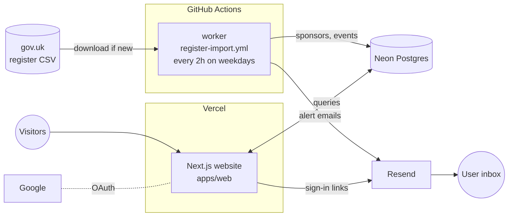
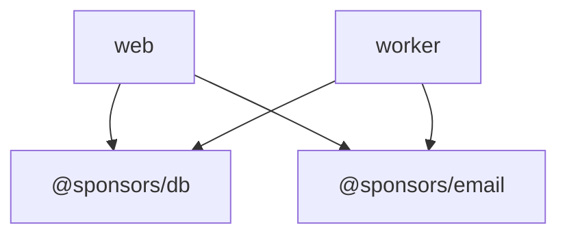
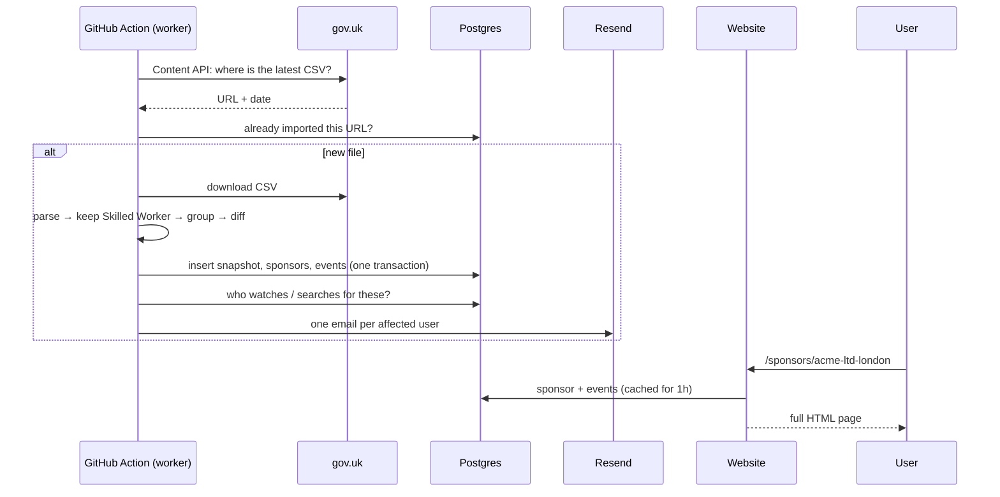

# 1. Architecture

## What the product does

1. Every working day the Home Office publishes a CSV of every organisation licensed to sponsor workers.
2. We download it, keep the **Skilled Worker** route only, and compare it with what we stored last time.
3. Differences become **events**: a sponsor was *added*, *removed*, *re-added*, or its *rating changed*.
4. The website lets anyone search sponsors, view a page per company with its history, and browse recent changes.
5. Signed-in users can **watch** companies and **save searches**; after each import they get one email
   summarising what changed for them.

## The three moving parts



| Part | Code | Runs on | Job |
|---|---|---|---|
| **Website** | `apps/web` | Vercel | Pages, search, sign-in, account, small JSON APIs |
| **Worker** | `apps/worker` | GitHub Actions (schedule) or `npm run worker` | Import the register, compute changes, send alerts |
| **Database** | `packages/db` (schema) | Neon | The single source of truth both of the above share |

The website and the worker **never talk to each other directly**. They only share the database. This is why
the worker can run anywhere: a GitHub Action, a cron job on a server, or your laptop.

## Monorepo layout

This is an **npm workspaces** monorepo: one `package.json` at the root lists the workspaces, and one
`npm install` sets up all of them. Packages refer to each other by name (`@sponsors/db`) and npm links them
via `node_modules/@sponsors/*` symlinks.

```
.
├── apps/
│   ├── web/            — Next.js 16 website          (package name: web)
│   └── worker/         — register import + alerts    (package name: worker)
├── packages/
│   ├── db/             — schema, connection, helpers  (package name: @sponsors/db)
│   └── email/          — sending + templates          (package name: @sponsors/email)
├── .github/workflows/  CI + scheduled jobs
├── docs/               you are here
├── DEPLOYMENT.md
└── .env                shared secrets (git-ignored)
```

**Dependency direction** (arrows mean "imports"):



`db` and `email` never import from `web` or `worker`. Keep it that way: shared code goes in `packages/`.

### Why packages aren't built

`packages/db` and `packages/email` export **TypeScript source** (`"exports": { ".": "./src/index.ts" }`).
There's no compile step:

- `apps/web` lists them in `transpilePackages` in `next.config.ts`, so Next.js compiles them as part of the app.
- `apps/worker` runs with `tsx`, which executes TypeScript directly.

This keeps the edit → run loop instant. The trade-off: these packages can't be published to npm as-is (we
don't need to).

## Data flow, end to end



## Key technologies

| Concern | Choice | Where to learn more |
|---|---|---|
| Language | TypeScript 5 (strict) | — |
| Website framework | Next.js 16 (App Router, Cache Components, Turbopack) | `node_modules/next/dist/docs/` (bundled with the installed version) |
| UI | React 19 + Tailwind CSS 4 | tailwindcss.com |
| Database | PostgreSQL (Neon) + `pg_trgm` extension for fuzzy search | neon.tech/docs |
| ORM / migrations | Drizzle ORM + drizzle-kit | orm.drizzle.team |
| Postgres driver | postgres.js v3 | github.com/porsager/postgres |
| Auth | Better Auth 1.7 (Google + magic link) | better-auth.com/docs |
| Email | Resend (REST API, no SDK) | resend.com/docs |
| CSV parsing | csv-parse | csv.js.org |
| Scheduler (self-hosted mode) | croner | — |
| TS runner for worker | tsx | — |
| Tests | Node's built-in `node:test` runner via `tsx --test` | nodejs.org/api/test.html |

> **Next.js 16 is newer than most tutorials.** Its caching model ("Cache Components") is different from Next.js
> 13–15. When in doubt, read the docs in `node_modules/next/dist/docs/`; they match the exact installed version.
> [The website doc](05-web-app.md#nextjs-16-cache-components-in-10-minutes) has a summary.
