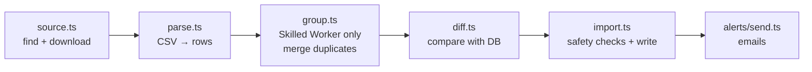
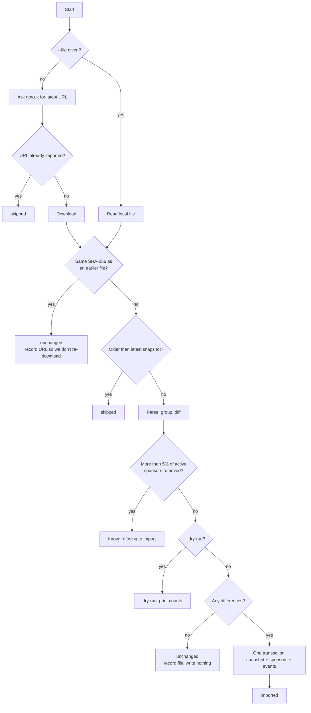

# 3. The data pipeline

How the Home Office register becomes sponsors and events in our database.
Code: `apps/worker/src/register/`.



## The source file

- Publication page: <https://www.gov.uk/government/publications/register-of-licensed-sponsors-workers>
- Updated most working days. **The file URL changes every time**, e.g.
  `.../SP_-_Worker_and_Temporary_Worker_Web_Register_-_2026-11-06.csv`
- Licence: Open Government Licence v3.0, so reuse is fine with attribution (in the site footer).
- ~143,000 rows, five columns:

| Column | Example | Notes |
|---|---|---|
| `Organisation Name` | `186 London Limited` | Inconsistent case and spacing; stray leading/trailing spaces |
| `Town/City` | `London` | The **registered address** town, not necessarily where jobs are |
| `County` | `Oxfordshire` | Often blank |
| `Type & Rating` | `Worker (A rating)` | Also `Worker (B rating)`, `Worker (A (Premium))`, `Worker (A (SME+))` |
| `Route` | `Skilled Worker` | One row **per route**, so an organisation can appear several times |

There is **no unique ID** per organisation, **no licence grant date**, and **no reason** is ever given for removals.
We don't keep the files: each is downloaded, compared, and only the differences are stored.

## Step 1: find and download (`source.ts`)

We don't scrape the HTML page. gov.uk has a public **Content API** that returns the page as JSON:

```
GET https://www.gov.uk/api/content/government/publications/register-of-licensed-sponsors-workers
→ details.attachments[] → the one with content_type "text/csv"
```

The register date is taken from the filename (`..._2026-11-06.csv`), falling back to the page's
`public_updated_at`. We also compute a **SHA-256** of the downloaded bytes to recognise identical files.

## Step 2: parse (`parse.ts`)

`csv-parse` turns the text into objects. Then:

- headers and values are passed through `cleanText()` (collapse whitespace, trim, handle non-breaking spaces);
- if any of the five expected columns is **missing, we throw**. If UKVI changes the format we'd rather fail loudly
  than import garbage and email thousands of false "removed" alerts.

## Step 3: group (`group.ts`)

1. Keep rows where `Route === "Skilled Worker"` (~123k of 143k).
2. Compute a **key** = `normalizeName(name) + "|" + normalizeTown(town)`.
3. Rows with the same key are merged into one sponsor (~900 cases, e.g. `186 LONDON LIMITED` and `186 London Limited`).

### Normalisation (`packages/db/src/normalize.ts`)

`normalizeName()` mirrors what Companies House treats as "the same name":

```
"Smith & Sons Ltd."  →  "smith and sons limited"
"SMITH AND SONS LIMITED"  →  "smith and sons limited"
```

lower-case → strip accents → `&` → `and` → drop punctuation → `ltd` → `limited` → collapse spaces.

The same function is used by search, so `"smith & sons"` typed by a user matches.

### Picking one value from merged rows

When rows merge, which name/county/rating do we show? The choice **must not depend on row order**: an earlier
version picked "the first row", and a re-ordered but otherwise identical file looked like 173 changes. So:

- **name/town**: prefer the variant that isn't ALL CAPS, then alphabetical;
- **county**: first non-empty, alphabetically;
- **rating**: any **B** wins (a downgrade on any merged licence is surfaced), otherwise alphabetical.

There's a regression test for this: *"grouping is independent of row order"*.

## Step 4: diff (`diff.ts`)

A **pure function**: `diffRegister(existingSponsorsFromDb, incomingGroupedSponsors)` returns:

| Bucket | Condition | Becomes event |
|---|---|---|
| `added` | key not in DB | `added` |
| `readded` | key in DB with status `removed` | `readded` |
| `updated` + `rating` | active, rating differs | `rating_changed` (old → new) |
| `updated` + `location` | county changed, **or** a same-name sponsor vanished from one town and appeared in another in the same file | `location_changed` ("Leeds" → "Bradford, West Yorkshire") |
| `updated` + `routes` | the set of visa routes held changed | `routes_changed` (routes joined with ` \| `) |
| `updated` only | name casing, merged-row count, first-time route fill | *no event*, just updated |
| `removed` | active in DB, key not in file | `removed` |

**Moves keep identity.** When exactly one sponsor with a given name disappears and exactly one appears elsewhere,
we treat it as a move: the row keeps its `id`, **slug** (so URLs and Google rankings survive) and watchers; only its
`key`, town and county change. Ambiguous cases (two same-name sponsors) stay as remove + add.

**Routes.** Grouping collects every route row with the same name + town, so a Skilled Worker sponsor's
`routes` might be `["Global Business Mobility: Senior or Specialist Worker", "Skilled Worker"]`. Sponsors stored
before route tracking have `routes = '{}'`; the next import fills them silently (no events).

**Bulk writes.** Updates go through one `UPDATE … FROM (VALUES …)` per 1,000 rows (`bulkUpdateSponsors`), so
filling routes for all ~122k sponsors takes seconds, not minutes.

Because it's pure (no DB), it's easy to test; see `register.test.ts`.

## Step 5: import (`import.ts`)

`runImport(options)` orchestrates everything. The decision tree:



(`--force` bypasses the duplicate, "older than" and 5% checks.)

### The baseline

The **first ever import** is the *baseline*: it inserts every sponsor with `in_baseline = true` and creates
**no events**. Otherwise the site would announce 122,000 "new sponsors" on day one. Sponsor pages say
"On the register since at least <date> (when we started tracking)" for these.

### What the transaction writes

1. `register_snapshots`: one row with counts.
2. `sponsors`: inserts for `added` (in batches of 1,000), updates for `readded` / `ratingChanged` /
   `detailsChanged`, status `removed` + `removed_at` for removals.
3. `sponsor_events`: one row per change, `occurred_at` = the register's publication date.
4. `last_seen_at` is bumped for all active sponsors.

Everything is in **one transaction**: if anything fails, nothing is written and the next run retries.

### Slugs

Each sponsor gets a URL slug: `slugify(name + " " + town)`, e.g. `tesco-stores-limited-welwyn-garden-city`.
On a collision we append `-2`, `-3`, … Slugs never change once assigned, which keeps URLs stable for Google.

## Step 6: alerts

After an import with changes, `sendPendingAlerts()` runs. Covered in [Accounts and alerts](06-auth-and-alerts.md#alert-emails).

## How it's scheduled

| Mode | How | When |
|---|---|---|
| **Production** | `.github/workflows/register-import.yml` | Weekdays 06:15–18:15 UTC every 2h; weekends 12:15 UTC |
| Self-hosted alternative | `npm run worker` (`apps/worker/src/index.ts`, uses `croner`) | Hourly at :10, Europe/London |
| Manual | `npm run import`, or GitHub → Actions → Register import → Run workflow | Whenever |

Each check is cheap: one small JSON request; the CSV is only downloaded when the URL is new.

## Limitations to be aware of

- **We can't tell *why* a sponsor was removed.** Revoked, surrendered, expired and renamed all look the same.
  UI and emails always say "removed from the register", never "revoked".
- **Renames look like remove + add.** Matching against Companies House numbers would fix this (future work).
- **Suspended licences also disappear** from the register; a later "Back on register" often means a suspension was lifted.
- **Two different companies with the same name in the same town** would merge. Rare, and indistinguishable
  without Companies House data.
- **Only unambiguous moves are detected.** If two same-name sponsors change at once, they show as remove + add.
