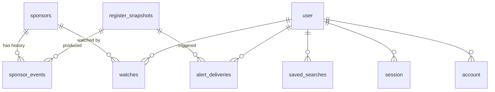
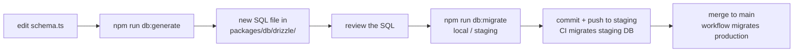

# 4. Database

PostgreSQL on Neon. Schema defined in TypeScript with **Drizzle**:

- `packages/db/src/schema.ts`: our tables
- `packages/db/src/auth-schema.ts`: tables Better Auth needs (`user`, `session`, `account`, `verification`)
- `packages/db/drizzle/*.sql`: generated migrations (the history of the schema)

## Entity diagram



## Register data

### `register_snapshots`: one row per register file we've seen

| Column | Meaning |
|---|---|
| `id` | serial |
| `source_url` | gov.uk CSV URL (unique), or `file://name.csv` for manual imports |
| `sha256` | hash of the file bytes |
| `published_at` | register date (from the filename) |
| `fetched_at` | when we processed it |
| `is_baseline` | first import: created no events |
| `has_changes` | `false` = file seen but identical in substance; nothing else was written |
| `total_rows`, `skilled_worker_rows`, `sponsor_count` | sizes |
| `added_count`, `removed_count`, `readded_count`, `rating_changed_count` | summary of the diff |
| `alerts_processed_at` | set once alert emails for this snapshot have been handled |

### `sponsors`: one row per Skilled Worker sponsor, current state

| Column | Meaning |
|---|---|
| `id` | serial |
| `key` | `normalized_name\|normalized_town`, the identity (unique) |
| `slug` | URL path segment (unique, never changes) |
| `name`, `town`, `county` | display values |
| `normalized_name`, `normalized_town` | for matching/search (see `normalize.ts`) |
| `rating` | `A`, `B`, `A (Premium)`, `A (SME+)` (or the raw text if UKVI invents a new one) |
| `rating_raw` | original text, e.g. `Worker (A rating)` |
| `entry_count` | how many register rows merged into this sponsor |
| `status` | `active` or `removed` |
| `in_baseline` | was already listed when tracking started |
| `first_seen_at`, `last_seen_at`, `removed_at` | dates from register publications |
| `company_number`, `website`, `careers_url` | **reserved for enrichment** (Companies House, website discovery); empty for now |
| `created_at`, `updated_at` | row timestamps |

### `sponsor_events`: the history

| Column | Meaning |
|---|---|
| `sponsor_id` → `sponsors.id` | |
| `snapshot_id` → `register_snapshots.id` | which file revealed it |
| `type` | enum `added`, `removed`, `readded`, `rating_changed` |
| `old_value`, `new_value` | for `rating_changed`: e.g. `A` → `B`; for added/readded: the rating |
| `occurred_at` | register publication date |

## Users and alerts

### Better Auth tables

| Table | Purpose |
|---|---|
| `user` | one per person. Our extra column: **`alerts_enabled`** (master switch; unsubscribe sets it false) |
| `session` | logged-in sessions (cookie token → user) |
| `account` | linked sign-in methods (e.g. Google) |
| `verification` | short-lived magic-link tokens (stored hashed) |

Don't rename columns in these. Better Auth expects these exact names. If you upgrade Better Auth, check its
changelog for schema changes.

### `watches`

`(user_id, sponsor_id)` primary key. "Email me when this company changes."

### `saved_searches`

| Column | Meaning |
|---|---|
| `query`, `town` | what the user typed (nullable; at least one is set) |
| `normalized_query`, `normalized_town` | matching values (`''` when not used) |

Unique on `(user_id, normalized_query, normalized_town)` so the same search can't be saved twice.
Matches **new and re-added sponsors** where name *contains* the query and town *equals* the town.

### `alert_deliveries`

One row per `(user, snapshot)`, **unique**. The worker inserts the row *before* sending; if the insert
conflicts, someone already handled it. That's what makes alerts idempotent.
`status`: `pending` → `sent` / `failed`; `provider_id` is Resend's email id; `error` holds failure messages.

## Indexes worth knowing

| Index | Serves |
|---|---|
| `sponsors_name_trgm_idx` (GIN, `gin_trgm_ops`) | `ILIKE '%foo%'` search and fuzzy "did you mean" (`<%` operator) |
| `sponsors_name_prefix_idx` (btree, `text_pattern_ops`) | 2-letter type-ahead (`LIKE 'de%'`) |
| `sponsors_status_town_idx` | search filtered by town |
| `sponsor_events_type_occurred_idx` | changes feed by type |
| `alert_deliveries_user_snapshot_idx` (unique) | idempotent alerts |

`pg_trgm` is a Postgres extension that indexes 3-letter chunks of text. It's enabled in the first migration
(`CREATE EXTENSION IF NOT EXISTS pg_trgm`).

## Migrations



Rules:

1. **Never edit a migration that's been applied anywhere.** Make a new one.
2. **Review the generated SQL** before committing. drizzle-kit sometimes proposes drop + create where you meant
   a rename. It asks interactively; read carefully.
3. **Keep changes additive** across a release (add a column → deploy → backfill → later make it required or drop
   the old one). The old site keeps serving for a minute while the new one deploys.
4. Custom SQL drizzle can't express (extensions, data backfills): generate an empty migration with
   `npx drizzle-kit generate --custom --name my_change` inside `packages/db`, then write the SQL.

drizzle-kit records applied migrations in `drizzle.__drizzle_migrations` in each database.

## Using Drizzle (cheat sheet)

```ts
import { and, desc, eq, ilike, sql } from 'drizzle-orm';
import { getDb, sponsors, sponsorEvents } from '@sponsors/db';

const db = getDb();

// select
const rows = await db.select().from(sponsors).where(eq(sponsors.slug, 'acme-ltd-london')).limit(1);

// pick columns + join
await db
  .select({ name: sponsors.name, type: sponsorEvents.type })
  .from(sponsorEvents)
  .innerJoin(sponsors, eq(sponsors.id, sponsorEvents.sponsorId))
  .orderBy(desc(sponsorEvents.occurredAt))
  .limit(20);

// raw SQL fragment when the builder can't express it
await db.select().from(sponsors).where(sql`${sponsors.normalizedName} % ${'deloite'}`);

// insert / upsert-ish
await db.insert(watches).values({ userId, sponsorId }).onConflictDoNothing();

// transaction
await db.transaction(async (tx) => { /* use tx instead of db */ });

// count
const n = await db.$count(watches, eq(watches.userId, userId));
```

`getDb()` creates **one connection pool per process** (stored on `globalThis` so Next.js hot reload doesn't
open new pools). `prepare: false` is set because Neon's pooled endpoint (PgBouncer) doesn't keep prepared
statements between transactions.

## Useful SQL

Run in Neon's SQL editor, or `npm run db:studio`.

```sql
-- How many active sponsors? How many B-rated?
select status, count(*) from sponsors group by status;
select count(*) from sponsors where status = 'active' and rating like 'B%';

-- Import history
select id, published_at::date, has_changes, added_count, removed_count, rating_changed_count, alerts_processed_at
from register_snapshots order by published_at desc limit 20;

-- What changed in the latest import?
select s.name, s.town, e.type, e.old_value, e.new_value
from sponsor_events e join sponsors s on s.id = e.sponsor_id
where e.snapshot_id = (select max(id) from register_snapshots where has_changes)
order by e.type, s.name;

-- History of one company
select e.occurred_at::date, e.type, e.old_value, e.new_value
from sponsor_events e join sponsors s on s.id = e.sponsor_id
where s.slug = 'tesco-stores-limited-welwyn-garden-city' order by e.occurred_at;

-- Users and what they follow
select u.email, u.alerts_enabled,
  (select count(*) from watches w where w.user_id = u.id) as watches,
  (select count(*) from saved_searches s where s.user_id = u.id) as searches
from "user" u order by u.created_at desc;

-- Alert sending problems
select a.created_at, u.email, a.status, a.error from alert_deliveries a
join "user" u on u.id = a.user_id where a.status <> 'sent' order by a.created_at desc;

-- Most watched companies
select s.name, s.town, count(*) from watches w join sponsors s on s.id = w.sponsor_id
group by s.id order by count(*) desc limit 20;
```

(`user` is a reserved word in Postgres, hence the quotes.)

## Neon branches

Neon "branches" are copy-on-write copies of the database:

| Branch | Used by |
|---|---|
| `main` | production website + scheduled import |
| `staging` | staging website, CI builds, **your local `.env`** |

To get fresh production data into staging: Neon → Branches → `staging` → **Reset from parent**.
This discards everything on staging (test users included).
