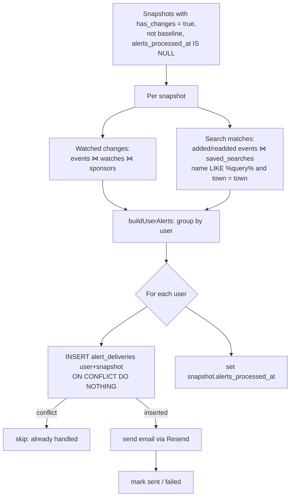

# 6. Accounts and alerts

## Sign-in (Better Auth)

Configured in `apps/web/src/lib/auth.ts`. Two ways to sign in, both producing the same kind of account:

| Method | Flow |
|---|---|
| **Magic link** | User enters email → we email a link → clicking it creates a session. Single-use, 15-minute expiry, token stored **hashed** |
| **Google** | Standard OAuth. Only offered when `GOOGLE_CLIENT_ID`/`SECRET` are set |

If someone signs in with Google and later with a magic link for the same email (or vice versa), it's **one
account** (`accountLinking` with Google as a trusted provider: Google verifies email ownership).

```mermaid
sequenceDiagram
  participant B as Browser
  participant W as Website (/api/auth)
  participant DB
  participant R as Resend
  B->>W: POST /api/auth/sign-in/magic-link {email, callbackURL}
  W->>DB: store hashed token (verification table)
  W->>R: email with /api/auth/magic-link/verify?token=…
  B->>W: GET verify link (from inbox)
  W->>DB: consume token, create user if new, create session
  W-->>B: Set-Cookie session; redirect to callbackURL
```

### Pieces

| File | Role |
|---|---|
| `lib/auth.ts` | Server config (`betterAuth({...})`). Server-only |
| `app/api/auth/[...all]/route.ts` | Mounts every Better Auth endpoint under `/api/auth/*` |
| `lib/auth-client.ts` | Browser client (`authClient.signIn.magicLink`, `.signIn.social`, `.useSession`, `.signOut`) |
| `lib/session.ts` | `getCurrentUser()` for server code; `isSameOrigin()`; `safeNext()` |

### Reading the user

```ts
// Server component / route handler
import { getCurrentUser } from '@/lib/session';
const user = await getCurrentUser(); // null when signed out

// Client component
import { authClient } from '@/lib/auth-client';
const { data, isPending } = authClient.useSession();
```

Server code that reads the session is per-request, so in a page it must be inside `<Suspense>`
(see `app/account/page.tsx`).

Sessions are cached in a signed cookie for 5 minutes (`cookieCache`) to avoid a DB lookup on every request.

### Adding Google sign-in

1. Google Cloud Console → APIs & Services → **OAuth consent screen**: app name, support email, your domain.
2. **Credentials → Create credentials → OAuth client ID → Web application.**
3. Authorised redirect URIs: `{SITE_URL}/api/auth/callback/google` for each environment (localhost, staging, production).
4. Put the ID and secret in `.env` / Vercel. The Google button appears automatically.

## Watches and saved searches

| Feature | UI | API | Table |
|---|---|---|---|
| Watch a company | `WatchButton` on company pages; list on `/account` | `/api/watch` | `watches` |
| New-sponsor alert | `SaveSearchButton` on search results; form on `/account` | `/api/saved-searches` | `saved_searches` |
| Master on/off | checkbox on `/account` | `/api/account/alerts` | `user.alerts_enabled` |

Limits: 500 watches and 20 saved searches per user (constants at the top of each route file).

## Alert emails

Code: `apps/worker/src/alerts/`. Runs after every import that had changes (and on every scheduler tick, to
retry anything a crash left behind).



- **One email per user per register update**, covering watched companies *and* saved searches.
- Users with `alerts_enabled = false` are excluded in the SQL.
- Saved-search sections show at most 15 sponsors, then "and N more →" linking to the search.
- Removals carry the note that the register doesn't say *why* a sponsor left.
- Sending is throttled to ~1.6/second (Resend's free tier allows 2/second).
- **At-most-once**: the delivery row is written *before* sending, so a crash mid-send can't cause duplicates
  (worst case, one email is lost and its row stays `pending`).

Templates: `packages/email/src/templates.ts` (`magicLinkEmail`, `alertEmail`). Plain HTML with inline styles
(email clients ignore `<style>` blocks) plus a text version.

## Unsubscribe

Every alert email contains:

- a visible **"Unsubscribe from all alerts"** link → `/unsubscribe?u=<userId>&t=<token>` (a page with a
  **confirm button**; email security scanners open links automatically, so a plain link-click mustn't unsubscribe);
- `List-Unsubscribe` + `List-Unsubscribe-Post: List-Unsubscribe=One-Click` headers, so Gmail/Apple Mail show
  their own unsubscribe button, which POSTs to `/api/unsubscribe` (RFC 8058). Gmail and Yahoo require this for bulk senders.

The token is `HMAC-SHA256(BETTER_AUTH_SECRET, "unsubscribe:" + userId)`, so it can't be forged, and it needs no DB
column. **That's why the worker and website must share the same `BETTER_AUTH_SECRET`** per environment.
Changing the secret invalidates old unsubscribe links (and signs everyone out).

## Email sending (`packages/email/src/send.ts`)

- Uses Resend's REST API with `fetch`. No SDK dependency.
- **No `RESEND_API_KEY` → prints the email to the console** instead. Handy locally.
- With Resend's test sender (`onboarding@resend.dev`) you can only send to your own Resend account email.
  To email real users, verify a domain in Resend and set `EMAIL_FROM` to an address on it.

## Security notes

| Concern | Mitigation |
|---|---|
| CSRF on our JSON APIs | `SameSite=Lax` session cookie (Better Auth default) + `Origin` header check (`isSameOrigin`) |
| Open redirects after login | `safeNext()` only allows paths starting with a single `/`; Better Auth also validates callback URLs against its base URL |
| Magic-link theft from DB | tokens stored hashed (`storeToken: 'hashed'`), single-use, 15 min expiry |
| Brute-force sign-in requests | Better Auth's built-in rate limiter (on in production; in-memory per server instance) |
| Users touching others' data | every query filters by the session's `user.id`; ids from the client are never trusted alone |
| Forged unsubscribes | HMAC token, constant-time comparison |
| Secrets in git | `.env` git-ignored; CI uses GitHub secrets; checked before every commit so far |
| XSS | React escapes output; JSON-LD is serialised with `<` escaped; email templates escape all values |

What's **not** there yet (consider before growing): account deletion / data export (UK GDPR rights; currently
you'd delete the `user` row by hand, which cascades), a privacy policy page, and a shared rate-limit store if
you run more than one server instance.
