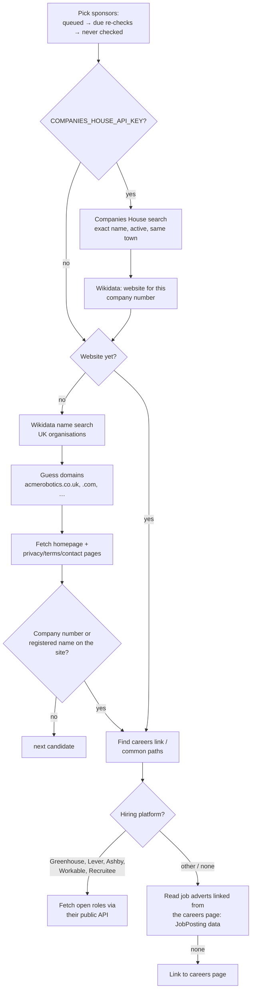

# 9. Websites, careers pages and jobs (enrichment)

The register only gives a name, town, county, rating and routes. Everything else on a company page
(website, careers page, open roles, Companies House details) comes from the **enrichment** job.
Code: `packages/enrich/` (shared by the worker and the website; the batch runner is `apps/worker/src/enrich-run.ts`).
Stored in `sponsor_profiles` and `jobs`.



## How a website is accepted

We never show a website we can't tie to the organisation. In order of strength (`website_verified_by`):

| Evidence | Value | Notes |
|---|---|---|
| Wikidata lists the site against the Companies House number | `wikidata` | Needs a Companies House key to know the number |
| The Companies House number appears on the site | `company_number` | UK companies must display it; usually in the footer or privacy policy |
| The full registered name ("Acme Robotics Ltd") appears on the site | `company_name` | Only for names with a legal suffix (Ltd, PLC, LLP, CIC) |
| GOV.UK's local-council list gives the council's homepage | `govuk` | Councils (`gov.uk/api/local-authority/<slug>`, name must match) |
| The NHS Organisation Data Service lists the website | `nhs_ods` | NHS trusts and boards, matched on exact name |
| A protected public-sector domain (.gov.uk, .nhs.uk, .ac.uk, .sch.uk, .police.uk…) whose title names the organisation, or whose address matches the name and page names it | `public_domain` | Only real public bodies can register these. Covers universities (`leeds.ac.uk`), colleges and others found via guesses or Wikidata |
| The domain *is* the name, the title names it, and the page mentions its town | `domain_and_title` | Weakest; only for distinctive names of 6+ letters |

Parked/for-sale domains are rejected. Generic names ("Care Services Ltd") and very short names are never guessed.

## Hiring platforms

| Provider | Jobs listed? | Public endpoint |
|---|---|---|
| Greenhouse | ✓ | `boards-api.greenhouse.io/v1/boards/{slug}/jobs` |
| Lever | ✓ | `api.lever.co/v0/postings/{slug}?mode=json` |
| Ashby | ✓ | `api.ashbyhq.com/posting-api/job-board/{slug}` |
| Workable | ✓ | `apply.workable.com/api/v1/widget/accounts/{slug}` |
| Recruitee | ✓ | `{slug}.recruitee.com/api/offers/` |
| Workday | ✓ | `POST {tenant}.wdN.myworkdayjobs.com/wday/cxs/{tenant}/{site}/jobs` (paged 20 at a time, capped at 200 roles). Slug stored as `tenant.wdN/site` |
| Teamtailor, Pinpoint, SmartRecruiters, BambooHR, Personio, Jobvite, iCIMS, custom sites | ✓ when the adverts carry `JobPosting` data | read off the careers page (below), else careers link only |
| iTrent, Oracle Recruiting, Oleeo (tal.net), NHS Jobs, Trac, SuccessFactors, Jobtrain (councils, NHS, universities) | link only | their vacancy-list link is stored as `vacancies_url` ("Current vacancies" button, session ids removed) |

### Jobs from the careers page itself

When there's no API we can read, `careers-page.ts` looks for links on the careers page that point at individual adverts
(`/careers/jobs/123-compliance-analyst`, `/vacancies/senior-engineer`…) and opens up to 25 of them. A role is only
listed when its page carries schema.org `JobPosting` structured data (which Google for Jobs requires, so most hiring
systems include it); that gives the employer's own title, location and posting date, and stops links like
"/careers/life-at-acme" being shown as jobs. Stored with `source = 'careers_page'`. Refreshes reuse roles already read,
so only new adverts are fetched.

Jobs are refreshed daily for hiring-platform APIs and every 3 days for careers pages (`refreshJobs`) and rows that disappear from the board are deleted. `is_uk` is decided from
country codes when available, otherwise from UK place names (`location.ts`; "New York", "London, Ontario" and US
state codes are excluded).

## Being a good citizen

- Identifies itself: `SponsorshipHunterBot/0.1 (+https://www.sponsorshiphunter.com/about)`.
- Obeys `robots.txt` (our agent's rules, else `*`).
- At most a handful of pages per site; 10 s timeout and 1.5 MB cap per page.
- Refuses private/internal network addresses (protects the runner).
- Companies House: throttled to ~1.6 requests/second (their limit is 600 per 5 minutes).

## Looking a company up when someone opens its page

A company page that hasn't been researched (or whose last search found nothing more than an hour ago) shows
"Checking their website and open roles now…" and calls `POST /api/profile-request`. The website runs the same lookup
there and then (usually 2–5 seconds, `maxDuration` 60 s) and the page refreshes itself with the result. Guards:

- one lookup per company per 15 minutes (`sponsor_profiles.lookup_started_at`), at most 20 across the site per 10 minutes (each lookup also costs about one Vercel ISR write when the page is next viewed);
- bots and crawlers (by user agent) and removed sponsors are only queued for the worker;
- anything not done immediately stays queued (priority 5) for the next worker run.

Needs `COMPANIES_HOUSE_API_KEY` in Vercel as well as GitHub for the best matches.

## Job-board searches

Every checked company page links to Indeed, LinkedIn, Glassdoor, Reed and Totaljobs' own searches for the employer's
name and town: as buttons when we found **no careers page and no jobs**, and as one "Also search for their jobs on…" line
under the roles or careers link when we did (employers often post on both)
(`components/JobBoardLinks.tsx`; trading name used for "X Ltd t/a Y", legal suffixes dropped). These are display only:
nothing is stored, so the company still counts as having no careers page and is re-checked on the normal schedule
(30 days for "not found", 60 days for a website without careers page, or an hour after a "not found" when someone
opens the page). We don't scrape those sites: they have no public API for this and their terms forbid it.

## Public bodies

Councils, NHS bodies, universities, colleges, schools and police forces have no Companies House number, so they get
their own steps (`public-bodies.ts`), tried before Wikidata and ordinary guesses: GOV.UK for councils, NHS ODS for NHS
bodies, then guesses on protected domains (`leeds.gov.uk`, `brighton.ac.uk`). No brand-only guesses for them
("leeds.com" is never the council). Their job systems (iTrent, NHS Jobs/Trac, Oleeo…) usually can't be read, so they
get the careers link, plus a "Current vacancies" link to the hiring system when it's separate. When an official
site blocks our bot (fife.gov.uk), a `jobs.`/`careers.`/`recruitment.` subdomain of the same protected domain is used as
the careers link after a DNS check only; the site itself isn't fetched.

## robots.txt

We honour `Allow`/`Disallow` with `*` wildcards and `$` anchors, most specific rule winning (Google's rules). Before
this, a rule like `Disallow: /*/media/oembed` (standard in Drupal, common on council sites) was read as "block
everything", so those sites were never fetched.

## Domain guesses

From the registered name minus company-type words: `acmerobotics.co.uk`, `acme-robotics.com`, … then the brand on its
own for distinctive first words (`RHAELM Operations Limited` → `rhaelm.com`). A brand-only domain can never pass the
weak "domain is the name" check, so it's only accepted when the site shows the company number or full registered name.

## Queue and priorities

`sponsor_profiles.status` = `queued` → `done` / `not_found` / `error`.

| Trigger | Priority |
|---|---|
| Someone watches the company (`POST /api/watch`) | 10 |
| Someone opens a company page with no profile yet (`ProfileRequest` → `POST /api/profile-request`; usually looked up immediately) | 5 |
| Background sweep (newest sponsors first) | — (no profile row yet) |

Re-checks: websites found → 60 days; not found → 30 days; errors → 1–7 days (backing off).

After every 25 saved results (and after job refreshes) the worker calls the website's `/api/revalidate`, so
company pages show new websites/jobs on the next visit instead of after the hourly cache expires. This needs
`SITE_URL` and `BETTER_AUTH_SECRET` (the workflow passes `PROD_`/`STAGING_` values). Vercel's preview protection
blocks it on staging, where pages fall back to the hourly refresh.

## Running it

```bash
npm run enrich                                    # up to 100 sponsors + refresh due job boards
npm run enrich -- --limit 300 --concurrency 8
npm run enrich -- --sponsor monzo-bank-ltd-london --dry-run   # one company, verbose, not saved
```

In production: `.github/workflows/enrich.yml`, every 4 hours, 150 sponsors per run (≈900/day). Manual runs can
target staging. At that pace a full sweep of ~122k sponsors takes months; the queue makes sure the companies people
actually look at are done first.

## Expected coverage

From a sample run: well-known companies are found reliably; small businesses much less often (many have no
website, or one whose name differs from the registered name). A **Companies House API key** raises coverage and
confidence: free at <https://developer.company-information.service.gov.uk/>, add as the `COMPANIES_HOUSE_API_KEY`
repo secret.

## Why some big employers show no jobs

- **Website not matched**: the site doesn't show the exact registered name ("PricewaterhouseCoopers LLP" vs pwc.co.uk).
  A Companies House key fixes many via the Wikidata company-number lookup.
- **Careers on an unsupported system** (SuccessFactors, Avature, Oracle, Phenom/Radancy) or a careers page built
  with JavaScript, where links aren't in the HTML. We show the careers link when we find one.

## Ideas to improve coverage

- A search API (e.g. Brave Search) as another candidate source, verified the same way.
- Let signed-in users suggest a website, accepted only if it passes verification.
- Job boards (Adzuna, Reed) matched to sponsor names, for companies without their own hiring platform.

## Care registers (home care)

`apps/worker/src/care/` matches licensed sponsors to the care regulators' public registers, monthly
(`.github/workflows/care-registers.yml`, `npm run care -w worker`; `--dry-run`, or `--cqc-file`/`--ci-file` for local copies).

- **Sources** (both Open Government Licence; the latest file is found on each publisher's page every run):
  CQC's monthly care directory CSV (England, service type "Homecare agencies") and the Care Inspectorate's datastore CSV
  (Scotland, subtype "Care at Home"; Windows-1252 encoded). Wales (CIW) and Northern Ireland publish no downloadable list.
- **Matching** (`match.ts`, tested): provider name vs sponsor name after dropping "Ltd/Limited/UK/The" and "t/a" parts (the
  trading name after "t/a" is tried too). Accepted when a registered service is in the sponsor's town (`name_and_town`), or when
  the sponsor's name is a registered company name (Ltd/PLC/LLP) and only one provider has it (`company_name`).
- **Storage**: `care_registrations`, one row per sponsor and regulator, for every matched provider (dentists, GPs, care homes
  too), with `home_care` true when at least one service is home care. Each run replaces a regulator's rows; a failed download or
  a file with too few home-care services (`MIN_HOME_CARE_SERVICES`) keeps last month's rows.
- **Used by**: the "Home care (domiciliary)" industry (`careRegister: 'home_care'` in `lib/industries.ts`: registered home-care
  providers, plus name/SIC matches that no regulator lists as something else) and the company page ("Registered home care
  provider", CQC link). Only home-care changes trigger company page refreshes.
- **CQC ratings** (`care/ratings.ts`): CQC publishes ratings only as a ~28 MB .ods (a ~1.1 GB XML inside). The job downloads it,
  streams `content.xml` through `unzip -p` and reads the "Locations" sheet (~10 s), keeping the overall rating of each
  *home-care* location (location IDs from the directory CSV), summarised per provider ("Good", "Good (all 3 services)",
  "2 Good, 1 Requires improvement", "Not yet rated"). Stored in `care_registrations.rating`; shown as "CQC rating" on the
  company page. If the file can't be read, last month's ratings are kept. Local: `--cqc-ratings-file ratings.ods`.
- November 2026 numbers: 3,995 CQC and 244 Care Inspectorate home-care sponsors; 4,364 on the industry page (581 by name alone);
  2,782 with a CQC rating, 1,213 registered but not yet inspected.

## Suggested links

Signed-in users can suggest a company's website or careers page from its company page ("Suggest a link",
`components/SuggestLink.tsx` → `POST /api/suggestions`, max 10 per user per day). Stored in `link_suggestions`.

- **Checked like our own search** (`packages/enrich/src/suggestions.ts`): links are tidied and refused if they're job boards,
  social media, search engines or directories (`normalizeSuggestedUrl`). A website is accepted automatically when the page or its
  privacy/terms/contact pages show the company number or full registered name (`verifyPage`); only then does the full lookup
  run, so a check takes a few seconds. A careers page is accepted when it's on the confirmed website (subdomains count) or proves
  the owner the same way. Anything else waits in **/admin/suggestions** (approve / reject; accepted ones can be removed).
- **Kept on every re-check**: `discoverSponsor()` / `enrichSponsor()` pass accepted links into `discover(s, known)`. An
  admin-approved website is trusted even if the site blocks bots; an automatically accepted one is re-verified. A suggested page
  on a group site (".../our-care-homes/grosvenor-park/") is kept as the full page, not just the domain. A suggested careers page
  wins over our own careers search, and works even when no website was found.
- Company page wording: `websiteVerifiedBy = 'admin'` → "Website suggested by a visitor and checked by us".

## Job boards (Reed)

Companies' own adverts on Reed, alongside the roles read from their own careers site (`packages/enrich/src/reed.ts`, `boards.ts`).

- **Search**: Reed's free Jobseeker API (`REED_API_KEY`, Basic auth, key as user name; never follows redirects so the key only
  goes to Reed). One call per company: keywords = the name without "Ltd"/"t/a…", up to 100 results, then only adverts whose
  advertiser name *is* the sponsor (`employerKey`) are kept, so recruitment-agency adverts and similarly named firms are left out.
- **When**: when a signed-in user opens a company page (`GET /api/board-jobs`, called by `components/ReedJobs.tsx`), if the last
  check is over 3 days old; and every enrichment run for watched companies (`refreshWatchedBoardJobs`, `--reed-limit`, default 150).
- **Allowance**: `api_usage` counts calls per London day; `REED_DAILY_LIMIT` (default 900) is shared by the site and the worker.
  `board_checks` records each company's last check (claimed at the start, so two visitors don't trigger two searches; a failed
  search is retried after an hour).
- **Storage**: rows in `jobs` with `source = 'reed'` (salary text in `department`). They are kept apart from the company's own
  roles: own-site refreshes don't delete them, `/api/jobs` and the public data API (`/api/v1`) exclude them (`ownSiteJobs()`).
- Shown as "On Reed: N adverts posted by them" with a "Jobs by reed.co.uk" credit, signed-in users only.

## NHS bodies and NHS Jobs

- **Websites** (`public-bodies.ts`): NHS bodies are matched to the NHS organisation directory (ODS) by their key words,
  ignoring "The", "NHS", "Foundation", "Trust", word order and short forms (ICB, UHB): `nhsNameKey`. So "The Great Western
  Hospitals NHS Foundation Trust", "Bradford District Care Trust NHS" and "Oxford University Hospitals NHS Trust" (directory:
  "…Foundation Trust") all match. Only directory entries that look like NHS organisations are accepted.
- **Vacancies** (`nhs-jobs.ts`): NHS Jobs' official, free Self-Serve Job Adverts API
  (`https://www.jobs.nhs.uk/api/v1/search_xml`, no key; guidance from NHSBSA). Each employer has a code (e.g. `C9273`, also the
  start of its advert IDs). We take it from an `employerCode=` link on the careers page, or search the feed by name and take it
  from adverts whose employer name matches (`nhsEmployerCode`). Adverts are read by code, external only, up to 300 (100 a page),
  and stored as the company's own roles (`ats_provider = 'nhsjobs'`, salary and closing date in `department`), so the normal
  daily job refresh keeps them current. Covers England and Wales; NHS Scotland and TRAC stay as links.
- Who is checked: names matching `NHS_JOBS_EMPLOYER` (NHS, health board, ambulance service, surgery, medical practice/centre,
  health centre, hospice, primary care network), even when no website was found. Migration 0014 queued all ~1,700 of them once
  (NHS bodies first).
- The jobs panel says "Vacancies on NHS Jobs", credits NHS Jobs and links "See all N roles on NHS Jobs".

