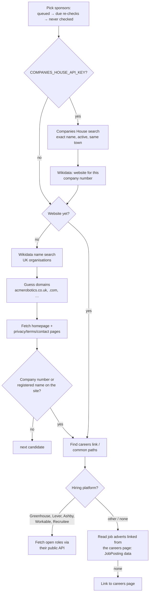

# 9. Websites, careers pages and jobs (enrichment)

The register only gives a name, town, county, rating and routes. Everything else on a company page
(website, careers page, open roles, Companies House details) comes from the **enrichment** job.
Code: `packages/enrich/` (shared by the worker and the website; the batch runner is `apps/worker/src/enrich-run.ts`).
Stored in `sponsor_profiles` and `jobs`.



## How a website is accepted

We never show a website we can't tie to the organisation. In order of strength (`website_verified_by`):

| Evidence | Value | Notes |
|---|---|---|
| Wikidata lists the site against the Companies House number | `wikidata` | Needs a Companies House key to know the number |
| The Companies House number appears on the site | `company_number` | UK companies must display it; usually in the footer or privacy policy |
| The full registered name ("Acme Robotics Ltd") appears on the site | `company_name` | Only for names with a legal suffix (Ltd, PLC, LLP, CIC) |
| The domain *is* the name, the title names it, and the page mentions its town | `domain_and_title` | Weakest; only for distinctive names of 6+ letters |

Parked/for-sale domains are rejected. Generic names ("Care Services Ltd") and very short names are never guessed.

## Hiring platforms

| Provider | Jobs listed? | Public endpoint |
|---|---|---|
| Greenhouse | ✓ | `boards-api.greenhouse.io/v1/boards/{slug}/jobs` |
| Lever | ✓ | `api.lever.co/v0/postings/{slug}?mode=json` |
| Ashby | ✓ | `api.ashbyhq.com/posting-api/job-board/{slug}` |
| Workable | ✓ | `apply.workable.com/api/v1/widget/accounts/{slug}` |
| Recruitee | ✓ | `{slug}.recruitee.com/api/offers/` |
| Workday | ✓ | `POST {tenant}.wdN.myworkdayjobs.com/wday/cxs/{tenant}/{site}/jobs` (paged 20 at a time, capped at 200 roles). Slug stored as `tenant.wdN/site` |
| Teamtailor, Pinpoint, SmartRecruiters, BambooHR, Personio, Jobvite, iCIMS, custom sites | ✓ when the adverts carry `JobPosting` data | read off the careers page (below), else careers link only |

### Jobs from the careers page itself

When there's no API we can read, `careers-page.ts` looks for links on the careers page that point at individual adverts
(`/careers/jobs/123-compliance-analyst`, `/vacancies/senior-engineer`…) and opens up to 25 of them. A role is only
listed when its page carries schema.org `JobPosting` structured data (which Google for Jobs requires, so most hiring
systems include it); that gives the employer's own title, location and posting date, and stops links like
"/careers/life-at-acme" being shown as jobs. Stored with `source = 'careers_page'`. Refreshes reuse roles already read,
so only new adverts are fetched.

Jobs are refreshed daily for hiring-platform APIs and every 3 days for careers pages (`refreshJobs`) and rows that disappear from the board are deleted. `is_uk` is decided from
country codes when available, otherwise from UK place names (`location.ts`; "New York", "London, Ontario" and US
state codes are excluded).

## Being a good citizen

- Identifies itself: `SponsorshipHunterBot/0.1 (+https://www.sponsorshiphunter.com/about)`.
- Obeys `robots.txt` (our agent's rules, else `*`).
- At most a handful of pages per site; 10 s timeout and 1.5 MB cap per page.
- Refuses private/internal network addresses (protects the runner).
- Companies House: throttled to ~1.6 requests/second (their limit is 600 per 5 minutes).

## Looking a company up when someone opens its page

A company page that hasn't been researched (or whose last search found nothing more than an hour ago) shows
"Checking their website and open roles now…" and calls `POST /api/profile-request`. The website runs the same lookup
there and then (usually 2–5 seconds, `maxDuration` 60 s) and the page refreshes itself with the result. Guards:

- one lookup per company per 15 minutes (`sponsor_profiles.lookup_started_at`), at most 20 across the site per 10 minutes (each lookup also costs about one Vercel ISR write when the page is next viewed);
- bots and crawlers (by user agent) and removed sponsors are only queued for the worker;
- anything not done immediately stays queued (priority 5) for the next worker run.

Needs `COMPANIES_HOUSE_API_KEY` in Vercel as well as GitHub for the best matches.

## Job-board searches (no careers page)

When a company has been checked and we found **no careers page and no jobs** (whether or not we found a website), its
page shows links that open Indeed, LinkedIn, Glassdoor, Reed and Totaljobs' own searches for the employer's name and town
(`components/JobBoardLinks.tsx`; trading name used for "X Ltd t/a Y", legal suffixes dropped). These are display only:
nothing is stored, so the company still counts as having no careers page and is re-checked on the normal schedule
(30 days for "not found", 60 days for a website without careers page, or an hour after a "not found" when someone
opens the page). We don't scrape those sites: they have no public API for this and their terms forbid it.

## Domain guesses

From the registered name minus company-type words: `acmerobotics.co.uk`, `acme-robotics.com`, … then the brand on its
own for distinctive first words (`RHAELM Operations Limited` → `rhaelm.com`). A brand-only domain can never pass the
weak "domain is the name" check, so it's only accepted when the site shows the company number or full registered name.

## Queue and priorities

`sponsor_profiles.status` = `queued` → `done` / `not_found` / `error`.

| Trigger | Priority |
|---|---|
| Someone watches the company (`POST /api/watch`) | 10 |
| Someone opens a company page with no profile yet (`ProfileRequest` → `POST /api/profile-request`; usually looked up immediately) | 5 |
| Background sweep (newest sponsors first) | — (no profile row yet) |

Re-checks: websites found → 60 days; not found → 30 days; errors → 1–7 days (backing off).

After every 25 saved results (and after job refreshes) the worker calls the website's `/api/revalidate`, so
company pages show new websites/jobs on the next visit instead of after the hourly cache expires. This needs
`SITE_URL` and `BETTER_AUTH_SECRET` (the workflow passes `PROD_`/`STAGING_` values). Vercel's preview protection
blocks it on staging, where pages fall back to the hourly refresh.

## Running it

```bash
npm run enrich                                    # up to 100 sponsors + refresh due job boards
npm run enrich -- --limit 300 --concurrency 8
npm run enrich -- --sponsor monzo-bank-ltd-london --dry-run   # one company, verbose, not saved
```

In production: `.github/workflows/enrich.yml`, every 4 hours, 150 sponsors per run (≈900/day). Manual runs can
target staging. At that pace a full sweep of ~122k sponsors takes months; the queue makes sure the companies people
actually look at are done first.

## Expected coverage

From a sample run: well-known companies are found reliably; small businesses much less often (many have no
website, or one whose name differs from the registered name). A **Companies House API key** raises coverage and
confidence: free at <https://developer.company-information.service.gov.uk/>, add as the `COMPANIES_HOUSE_API_KEY`
repo secret.

## Why some big employers show no jobs

- **Website not matched**: the site doesn't show the exact registered name ("PricewaterhouseCoopers LLP" vs pwc.co.uk).
  A Companies House key fixes many via the Wikidata company-number lookup.
- **Careers on an unsupported system** (SuccessFactors, Avature, Oracle, Phenom/Radancy) or a careers page built
  with JavaScript, where links aren't in the HTML. We show the careers link when we find one.

## Ideas to improve coverage

- A search API (e.g. Brave Search) as another candidate source, verified the same way.
- Let signed-in users suggest a website, accepted only if it passes verification.
- Job boards (Adzuna, Reed) matched to sponsor names, for companies without their own hiring platform.
